# Arquitetura do MVP (proposta)

## Fluxo

```mermaid
flowchart LR
  A[Imagem própria ou consentida] --> B[Validação de formato e limites]
  B --> C[Inventário de metadados e orientação]
  C --> D[Normalização de pixels]
  D --> E[OCR local: candidatos]
  E --> F[Revisão humana e edição de regiões]
  F --> G[Redação opaca ou corte]
  G --> H[Reencodificação em arquivo novo]
  H --> I[Verificação de metadados e inspeção residual]
  I --> J[Exportação com relatório de limites]
```

## Componentes sugeridos

Python para CLI e processamento; Pillow para decodificação/reencodificação e orientação; Tesseract como adaptador OCR local inicial. Uma interface local pode vir depois da CLI. Fixar versões e revisar dependências antes da implementação. Não há necessidade de LangGraph ou múltiplos agentes no primeiro marco: o fluxo é determinístico, com detecção substituível e revisão humana explícita.

- `ingest`: allowlist JPEG/PNG estáticos, assinatura real do arquivo, limite de bytes/pixels e proteção contra decompression bombs; rejeitar formatos desconhecidos e animações.
- `metadata`: inventariar grupos presentes, não persistir valores pessoais no relatório padrão. Nunca copiar EXIF/XMP/IPTC, thumbnails, comentários ou blobs arbitrários para a saída.
- `detect`: OCR retorna regiões normalizadas, categoria, evidência mínima e origem. Confiança do OCR não representa probabilidade de dano. Sem classificador validado, utilizar `null` e incerteza explícita.
- `review`: lista revisável; aprovar/rejeitar/adicionar regiões. Sem decisão humana, nenhum rótulo “liberado para publicação”.
- `sanitize`: criar novo buffer de pixels e arquivo separado, preservar orientação visual, aplicar cobertura opaca/corte. Desfoque pode preservar informação; inpainting pode inventar conteúdo. Não usá-los como padrão de segurança.
- `verify`: reabrir saída, inspecionar metadados com ferramenta independente (ExifTool), executar novamente OCR e pedir revisão visual. Segunda leitura não garante ausência de vazamento.

## Fronteiras e contratos

Entradas nunca disparam comandos, abrem URLs, seguem QR Codes ou instruem o pipeline. Nomes de arquivo devem ser tratados como dados. Diretório temporário privado, política explícita de retenção e descarte; não sobrescrever o original. Saída possui nome novo e não incorpora nome/caminho pessoal no relatório. Não salvar fotos ou resultados sensíveis em git.

O contrato `schemas/finding.schema.json` é inicial. Coordenadas relativas à imagem normalizada: x/y representam canto superior esquerdo; largura/altura em [0,1]. Validar também x+w <= 1 e y+h <= 1 em código. Evidência e relatórios são locais e potencialmente sensíveis.

## Evolução após baseline

VLM local só após benchmark de OCR e revisão: adaptador sem ferramentas de rede, saída estruturada validada, nenhum acesso a shell, resistência a instruções em imagens. Não chamar heurística de “entropia geográfica” sem definição matemática, dados e calibração. Avaliar exposição observável, não tentar descobrir uma mesa/endereço de uma pessoa.

## Marcos de entrega

1. CLI metadados: fixture sintética + exportação nova + orientação correta + verificação independente.
2. OCR revisável: caixas e falsos positivos/negativos medidos em dataset consentido/sintético.
3. Sanitização: máscaras aprovadas e teste de vazamentos residuais, preservação do original.
4. Demo local: antes/depois e limitações; roteiro aprovado antes de publicação.
