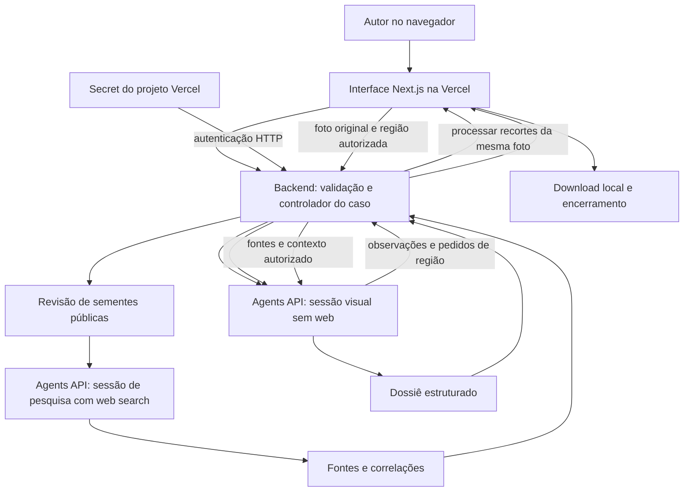

# Arquitetura da primeira versão

Desenho proposto em 2026-11-13. Substitui a arquitetura local/offline e a extensão com diversas APIs do desenho anterior. Esta etapa define o produto e seus contratos; não provisiona infraestrutura ou credenciais.

## Decisões de desenho

| Decisão | Escolha e motivo |
| --- | --- |
| Produto | Curadoria educativa de exposição virtual a partir de uma foto, com documento rastreável |
| Superfície | Next.js com TypeScript em um projeto Vercel; interface e backend no mesmo repositório |
| Backend | Route Handlers em Vercel Functions, runtime Node.js; validação e controle fora do modelo |
| IA | OpenAI Agents API; visão do modelo e web search nativo; sem chamadas separadas à Responses API |
| Execução | `environment.type = none`; sem sandbox, shell, MCP ou múltiplos agentes |
| Imagem | Bibliotecas de decodificação/normalização e metadados, candidatas Sharp e exifr; sem Tesseract na V1 |
| Credencial | `OPENAI_API_KEY` como Secret do projeto Vercel; detalhe em [OpenAI e secrets](openai-integration.md) |
| Acesso | Premissa V1 privada, protegendo UI e APIs com Vercel Authentication em todas as URLs utilizadas |
| Persistência | Sem banco, Blob ou histórico permanente da aplicação; sessões de trabalho na OpenAI, original no navegador e exportações no dispositivo |
| Resultado | Dossiê HTML na interface, Markdown e JSON para download; sem publicação automática |

Vercel Authentication é uma escolha para uso privado, não uma implementação de isolamento multiusuário. A configuração efetiva deve ser verificada antes do deploy, incluindo domínio de produção, previews e ausência de bypass público. Ver [documentação de acesso](https://vercel.com/docs/deployment-protection/methods-to-protect-deployments/vercel-authentication).

## Componentes e fronteiras

A sessão visual recebe pixels e contexto selecionado. A sessão de pesquisa recebe apenas sementes públicas revisadas, perguntas e limites. A síntese retorna à sessão visual, com web desabilitado. São duas sessões isoladas do mesmo fluxo de curadoria, sem time de agentes ou infraestrutura de orquestração adicional.

A chave autentica o backend na OpenAI; nunca é campo de prompt, ferramenta, imagem, mensagem, cookie ou dossiê.

## Fluxo e dados da imagem

1. O navegador mantém a foto selecionada em memória. O original enviado transita pela memória da Function para validação/inventário; não é gravado em armazenamento da aplicação.
2. Validar assinatura real, JPEG/PNG estático, bytes e pixels. Extrair metadados antes de reencodificar; não concluir “sem metadados” quando o parser falha.
3. Criar derivada orientada sem EXIF/XMP/IPTC/comentários/miniaturas copiados, registrar dimensões e vínculo ao original. A foto pode conter dados pessoais nos pixels; o envio à OpenAI é explicitado.
4. Enviar `input_image` e contexto autorizado à sessão visual. Metadados seguem como dados estruturados selecionados, nunca como um blob arbitrário.
5. O agente retorna observações e pedidos de região em saída estruturada. O controlador valida caixas, finalidade e limite antes da próxima leitura.
6. Para um recorte, o navegador reenvia o mesmo original; o backend verifica seu hash e aplica o recorte com referência à imagem orientada. O novo input é vinculado ao pedido e à evidência.
7. A revisão de sementes públicas autoriza a rodada web. O backend constrói uma nova entrada, sem copiar foto, inventário privado ou histórico visual.
8. A sessão de pesquisa usa web search nativo. O backend valida a estrutura/proveniência dos resultados antes de encaminhá-los à síntese.
9. A interface mostra o dossiê e as lacunas, permite revisar afirmações e exportar. Encerrar tenta cancelar trabalho ativo e excluir as duas sessões, relatando cada resultado.

A derivada enviada ao modelo não substitui o original como evidência. Reconhecimento visual de texto não equivale a OCR determinístico ou leitura confiável de toda região. Caixas do modelo são localizadores de revisão, não máscaras certificadas.

## Controle de exploração

A aplicação mantém uma fila de perguntas ligada às evidências. O [loop de exploração](exploration-loop.md) define ganho, parada por ramo/global e quais controles são do backend, do provedor ou instruções avaliadas do modelo. O [catálogo de fontes](source-catalog.md) delimita consultas automáticas e caminhos de autoavaliação manual; não adiciona APIs à V1.

## Limites iniciais

Proposta configurável a validar: arquivo até **3 MiB**, corpo multipart até **3,5 MiB**, até **16 megapixels**, derivada até **2048 px no maior lado** e **700 KiB**, no máximo **3 recortes**, **2 rodadas de enriquecimento web**, **5 perguntas prioritárias** e **2 elos semânticos de correlação** por caso. Duas ações consecutivas do controlador sem ganho encerram a exploração; limite de modalidade só bloqueia novas ações daquela modalidade.

A imagem inline deve respeitar também os limites do contrato OpenAI/base64. Se não couber, reduzir com limite explícito de qualidade ou rejeitar; não criar URL pública como alternativa silenciosa. Redução pode prejudicar texto pequeno; recortes preservam mais detalhe local.

As [Functions têm limites de payload e duração](https://vercel.com/docs/functions/limitations). Upload multipart evita enviar o original em base64 ao endpoint da aplicação. Os valores acima são escolhas conservadoras, não benchmark ou limites universais dos provedores.

## Execução sem worker persistente

O backend inicia turnos assíncronos da Agents API e responde com estado. A interface consulta progresso por requisições curtas; cada avanço de fase é iniciado pelo controlador em uma nova requisição. A execução de um turno permanece na OpenAI, não depende de manter uma Function aberta durante toda a pesquisa.

O navegador conduz o avanço entre fases. Se fechar a página, o turno atual pode continuar, mas o próximo estágio aguarda retomada. Não há promessa de conclusão autônoma de todo o pipeline com o navegador fechado.

Uma cookie de caso assinada, `HttpOnly`, `Secure`, `SameSite=Strict`, com expiração de 24h, guarda somente IDs opacos, hash de vínculo, fase e versões. `CASE_SIGNING_SECRET` fica como Secret separado. A cookie não contém a chave OpenAI, imagem, metadados ou dossiê. Apenas um caso ativo por navegador na V1.

A assinatura permite validar referências sem banco; não substitui o controle de acesso ao deployment. Nenhuma rota aceita um session ID arbitrário como autorização. Mutação exige origem válida e estado coerente. Perder a cookie pode impedir retomada; reabrir sem a foto exige selecionar novamente o mesmo arquivo para novos recortes.

Concorrência e retries: desabilitar ações duplicadas na UI e reconciliar sessão/turno antes de avançar. Não repetir criação ou envio cujo resultado é desconhecido. Sem ledger persistente, não prometer exactly-once ou cotas globais rígidas. Casos órfãos por falha entre criação e confirmação requerem reconciliação operacional no projeto OpenAI.

## Contratos HTTP propostos

Nomes são da aplicação; não são métodos do SDK.

| Rota | Responsabilidade |
| --- | --- |
| `POST /api/cases` | Validar foto/contexto/consentimento e iniciar análise visual |
| `GET /api/case` | Recuperar estado e itens da sessão vinculada à cookie |
| `POST /api/case/advance` | Reconciliar fase concluída, validar sementes ou iniciar síntese/pesquisa |
| `POST /api/case/region` | Validar mesmo original e região pedida; iniciar nova leitura visual |
| `POST /api/case/cancel` | Cancelar trabalho ativo, preservando resultado parcial recuperável |
| `DELETE /api/case` | Tentar cancelar/excluir sessões e limpar a cookie, com resultado verificável |

Estados da aplicação: `validating`, `analyzing`, `exploring`, `awaiting_search_review`, `researching`, `synthesizing`, `completed`, `partial`, `failed`, `cancelled`. Resultados do modelo não podem editar diretamente o estado confiável ou a política.

Downloads são gerados no navegador a partir do documento validado. Respostas de casos usam `Cache-Control: no-store`; nenhuma imagem/dossiê entra em CDN pública, analytics ou logs de payload.

## Armazenamento e retenção

| Dado | Local e ciclo |
| --- | --- |
| Original | Memória do navegador; transita pela Function; nenhum armazenamento persistente da aplicação |
| Derivadas e contexto enviados | Sessão visual OpenAI; ficam sujeitos ao contrato de retenção do serviço |
| Sementes e pesquisa | Sessão de pesquisa OpenAI; podem chegar aos provedores envolvidos na busca |
| Referências do caso | Cookie assinada por até 24h; expirar não exclui sessões remotas |
| Dossiê | Memória da interface e sessão de síntese; cópia local somente por download |
| Logs operacionais | IDs, estados, códigos e métricas; retenção configurada no projeto, sem conteúdo da foto |
| Credenciais | Secret do projeto Vercel; nunca nas sessões ou no dossiê |

Sem cron ou banco nesta versão, fechamento da aba e expiração da cookie não garantem limpeza remota. Disponibilizar encerramento explícito e procedimento operacional de revisão/exclusão de sessões órfãs. Exclusão solicitada, aceita e falha são estados diferentes; não prometer apagamento imediato de todos os sistemas ou backups.

## Implementação prevista e entrega

Frontend: seleção/envio, progresso, revisão de sementes, evidências e dossiê. Backend: imagem/metadados, controlador, adaptador Agents API, validação de saídas e gestão de caso/segredos. Contrato do resultado em [Documento de exposição](exposure-report.md); requisitos e aceite em [Requisitos](requirements.md).

Ordem: contratos/fixtures → processamento de imagem → sessão visual → exploração → pesquisa isolada → síntese/exportação → testes e preview privado → configuração de Secret e validação real limitada → produção privada. A etapa atual entrega somente o desenho e os critérios para essas fases futuras.

Antes do deploy: confirmar projeto/time/plano, modelo e permissões, proteção de todas as rotas, duração/configuração de Functions, credenciais e comportamento real de imagem, web e exclusão. Não provisionar serviços nem solicitar a chave durante esta etapa de documentação.
