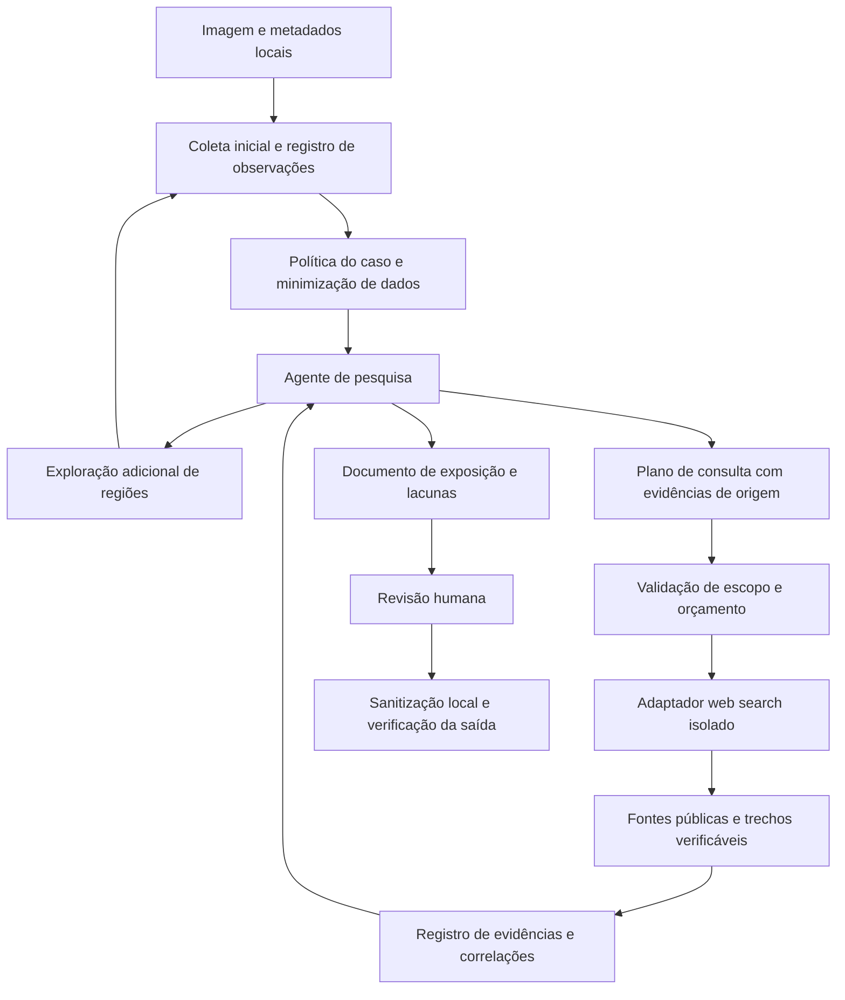

# Arquitetura: núcleo local e agente de pesquisa (proposta)

Decisão de escopo em 2026-11-12: acrescentar pesquisa web agêntica opcional e integrações OpenAI. O núcleo offline permanece disponível. Este documento substitui a restrição global a análises locais por dois modos explícitos; os componentes continuam propostos, sem implementação.

## Fluxo do núcleo offline

## Fluxo do modo conectado

O agente pode encerrar com relatório parcial, pedir esclarecimento ou voltar à imagem quando a web não resolve uma ambiguidade. Detalhes do ciclo, contratos e limites em [Agente de pesquisa](agent-research.md); divisão de responsabilidades na [integração OpenAI](openai-integration.md).

```mermaid
flowchart LR
  A[Imagem própria ou consentida] --> B[Validação de formato e limites]
  B --> C[Inventário de metadados e orientação]
  C --> D[Normalização de pixels]
  D --> E[OCR local: candidatos]
  E --> F[Revisão humana e edição de regiões]
  F --> G[Redação opaca ou corte]
  G --> H[Reencodificação em arquivo novo]
  H --> I[Verificação de metadados e inspeção residual]
  I --> J[Exportação com relatório de limites]
```

## Componentes sugeridos

Python para CLI e processamento; Pillow para decodificação/reencodificação e orientação; Tesseract como adaptador OCR local inicial. Uma interface local pode vir depois da CLI. Fixar versões e revisar dependências antes da implementação. O primeiro marco continua determinístico. A extensão usa um único agente com ferramentas tipadas, adaptadores substituíveis e revisão humana; não exige LangGraph nem múltiplos agentes. A preferência atual de integração é OpenAI, preservando o processamento de imagem em Python.

- `ingest`: allowlist JPEG/PNG estáticos, assinatura real do arquivo, limite de bytes/pixels e proteção contra decompression bombs; rejeitar formatos desconhecidos e animações.
- `metadata`: inventariar grupos presentes, não persistir valores pessoais no relatório padrão. Nunca copiar EXIF/XMP/IPTC, thumbnails, comentários ou blobs arbitrários para a saída.
- `detect`: OCR retorna regiões normalizadas, categoria, evidência mínima e origem. Confiança do OCR não representa probabilidade de dano. Sem classificador validado, utilizar `null` e incerteza explícita.
- `evidence`: observações locais, planos de busca, fontes web e afirmações com IDs e proveniência. Nunca transformar resposta do modelo em observação medida.
- `research_policy`: autorização por caso, projeção de dados para cada destino, classes de termos permitidos, domínios e orçamento; validação fora do modelo antes de cada chamada.
- `research_agent`: coleta inicial, plano, explorações locais, pedidos ao adaptador web e síntese. Sem shell ou ferramenta de rede genérica.
- `web_research`: recebe somente plano minimizado autorizado, consulta fontes públicas e devolve URLs, datas, trechos e estado de recuperação. Não recebe a foto, o OCR integral ou o histórico privado do planejador.
- `report`: documento local com observações, correlações, hipóteses, contradições, recomendações, cobertura e verificações. Relatório completo é sensível; versão compartilhável minimiza valores.
- `review`: lista revisável; aprovar/rejeitar/adicionar regiões. Sem decisão humana, nenhum rótulo “liberado para publicação”.
- `sanitize`: criar novo buffer de pixels e arquivo separado, preservar orientação visual, aplicar cobertura opaca/corte. Desfoque pode preservar informação; inpainting pode inventar conteúdo. Não usá-los como padrão de segurança.
- `verify`: reabrir saída, inspecionar metadados com ferramenta independente (ExifTool), executar novamente OCR e pedir revisão visual. Segunda leitura não garante ausência de vazamento.

## Fronteiras e contratos

Entradas nunca executam comandos nem instruem o pipeline. No modo offline, não abrem URLs ou seguem QR Codes. No modo conectado, URLs são candidatas a análise: somente o adaptador de pesquisa pode consultar fontes públicas, após validação da política. Conteúdo extraído não autoriza acesso externo por si só. Nomes de arquivo devem ser tratados como dados. Diretório temporário privado, política explícita de retenção e descarte; não sobrescrever o original. Saída possui nome novo e não incorpora nome/caminho pessoal no relatório. Não salvar fotos ou resultados sensíveis em git.

O contrato `schemas/finding.schema.json` é inicial. Coordenadas relativas à imagem normalizada: x/y representam canto superior esquerdo; largura/altura em [0,1]. Validar também x+w <= 1 e y+h <= 1 em código. Evidência e relatórios são locais e potencialmente sensíveis. O schema existente continua restrito a candidatos visuais; metadados e fontes web usam os contratos propostos em [Agente de pesquisa](agent-research.md), sem inventar caixas para dados não visuais.

## Evolução após baseline

Visão local ou OpenAI só após baseline de OCR e revisão: adaptador de percepção sem ferramentas de navegação, saída estruturada validada e nenhum acesso a shell. Visão remota exige recortes autorizados e sem metadados; sua interpretação é uma hipótese até revisão/corroboração. Resistência a instruções em imagens e páginas deve ser avaliada. Não chamar heurística de “entropia geográfica” sem definição matemática, dados e calibração. Avaliar exposição observável, não tentar descobrir uma mesa/endereço de uma pessoa.

## Marcos de entrega

1. CLI metadados: fixture sintética + exportação nova + orientação correta + verificação independente.
2. OCR revisável: caixas e falsos positivos/negativos medidos em dataset consentido/sintético.
3. Sanitização: máscaras aprovadas e teste de vazamentos residuais, preservação do original.
4. Demo local: antes/depois e limitações; roteiro aprovado antes de publicação.
5. Agente sem rede: coleta e exploração seletiva em fixtures, contratos tipados, política e paradas; pesquisa simulada com fontes fixas.
6. Pesquisa conectada: OpenAI e web search em um caso sintético/autorizado, consultas minimizadas e documento com citações verificadas; medir custo, qualidade e vazamento por consultas.
7. Interfaces opcionais: chat de revisão e GPT-Live usando a mesma política e estado do caso. GPT Image fica no ramo de demonstração sintética, separado da evidência.
