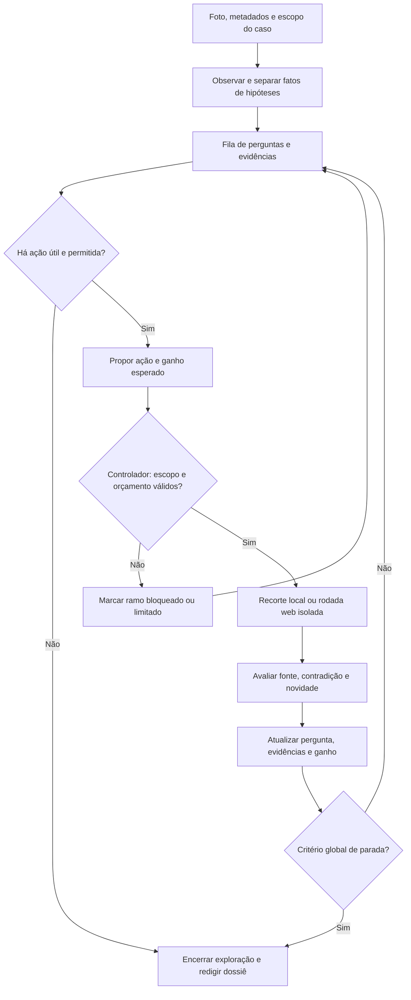

# Loop de exploração e critérios de parada

Proposta de 2026-11-13, sem implementação ou análise real. Complementa [Agente de curadoria](agent-research.md), [Catálogo de fontes](source-catalog.md) e [Contrato do dossiê](exposure-report.md).

## Princípio de decisão

Continuar somente quando a próxima ação puder mudar uma conclusão, resolver uma alternativa relevante ou alterar uma ação de proteção. Mais URLs, texto ou autoconfiança do modelo não são ganho suficiente.

A missão é demonstrar exposição e caminhos de correlação sobre uma foto própria/autorizada. Não é reconstruir uma identidade ou ampliar indefinidamente um grafo de pessoas. Informações publicamente acessíveis ainda podem exigir minimização e não autorizam qualquer finalidade.

## Loop lógico

A sessão visual não tem web search. O agente produz pedidos estruturados de recorte; o backend valida e executa a transformação. A sessão de pesquisa recebe apenas sementes revisadas. O loop acima é da aplicação: uma rodada web nativa pode conter múltiplas consultas internas, sem nova decisão do nosso controlador entre elas.

## 1. Observar antes de pesquisar

Registrar inventário de metadados e observações da imagem, distinguindo:
- sinal diretamente visível/extraído;
- contexto fornecido pelo autor;
- leitura ambígua;
- interpretação ou hipótese;
- dados que não devem virar termos de busca.

Sinais diretos de alta exposição, como segredo visível ou GPS preciso no arquivo, já podem justificar uma recomendação. Não é necessário verificar se uma credencial funciona ou localizar a coordenada para demonstrar a exposição.

## 2. Transformar sinais em perguntas finitas

Propor até cinco perguntas prioritárias por caso, deixando sinais restantes na lista de cobertura não explorada. Esse limite é uma escolha inicial de produto, a calibrar; não é uma taxa de acerto.

Exemplos: “a edição do evento pode ser distinguida?”, “o texto pequeno é legível?”, “o arquivo registra coordenadas?”, “o domínio visível permite reconhecer uma organização?”, “qual recomendação muda ao combinar estes sinais?”.

Cada pergunta tem `question_id`, evidências de origem, afirmação candidata, alternativa concorrente, critério de suficiência, ações já realizadas, profundidade e estado: `open`, `resolved`, `inconclusive`, `blocked` ou `not_explored`.

O critério de suficiência é escrito antes da consulta. Exemplo: nome completo e edição legíveis, com correspondência em uma página oficial, bastam para associar o texto a uma edição; não bastam para atribuir presença pessoal no evento.

## 3. Propor a próxima ação

Tipos da aplicação: `inspect_region`, `research_seed`, `request_context` e `conclude_branch`. São rótulos do controlador, não ferramentas adicionais de internet ou métodos OpenAI.

Uma proposta contém: pergunta; evidências/sementes; finalidade; classe de fonte; dados divulgados; resultado que mudaria a conclusão; profundidade; orçamento restante. Não precisa expor raciocínio interno do modelo.

Uma ação só é candidata se todas as condições forem verdadeiras:
1. Está ligada à foto ou a contexto explicitamente fornecido.
2. Pode resolver uma pergunta ou mudar uma recomendação.
3. Usa dados/destinos autorizados e fonte elegível.
4. Há capacidade de executar e registrar o resultado.
5. Ainda há orçamento e nenhuma regra de parada se aplica.

Entre candidatas, priorizar exposição direta e alternativas que possam evitar uma conclusão errada; depois, ganho útil com menor divulgação e menor custo. Não inventar uma fórmula de probabilidade de dano.

Pedir contexto ao autor apenas quando a resposta puder mudar uma decisão relevante. Não exigir identificadores pessoais para preencher a curiosidade do agente; se a resposta não vier, registrar a pergunta como inconclusiva. Espera por resposta humana não conta como tempo de trabalho ativo.

## 4. Executar e confrontar

Quando a leitura visual é ambígua, preferir um recorte à pesquisa de várias grafias tratadas como fatos. Usar a primeira rodada web para contexto primário; reservar a segunda, quando útil, para distinguir edições/homônimos ou buscar evidência contrária.

Uma fonte primária pertinente pode bastar para confirmar um fato público sobre um evento/produto. Duas páginas copiadas não são duas confirmações; várias correspondências frágeis não provam identidade, vínculo empregatício ou localização atual.

Registrar origem, data, estado de recuperação, trecho disponível e limitações. Resumo de buscador não vira página lida. Ausência de resultado pode refletir indexação, acesso, nome errado, prazo ou cobertura limitada.

## 5. Medir ganho sem premiar volume

Há ganho quando a evidência nova e pertinente:
- altera o estado de uma pergunta/afirmação;
- elimina ou sustenta uma alternativa identificada;
- esclarece um sinal relevante; ou
- modifica uma recomendação de proteção.

Nova URL duplicada, paráfrase do mesmo resultado ou maior confiança declarada sem suporte não contam. Contradição útil conta como ganho: ela pode corrigir a história inicialmente mais atraente.

O agente propõe a avaliação de ganho. O controlador confere execução, referências e duplicatas identificáveis; isso não lhe dá capacidade automática de provar novidade semântica ou verdade. Avaliar esse julgamento com fixtures, evidência e revisão humana, sem tratá-lo como sinal calibrado do modelo.

Duas ações consecutivas concluídas pelo controlador sem ganho encerram a exploração global. Por ramo, permitir a ação inicial e, no máximo, uma tentativa direcionada adicional sem ganho. Esses contadores não representam as consultas internas do provedor.

## 6. Limites e parada

| Nível | Critério | Resultado |
| --- | --- | --- |
| Ramo: suficiente | Pergunta atingiu seu critério de suficiência | `resolved`; não continuar só para acumular fontes |
| Ramo: sem resolução | Tentativa direcionada adicional não mudou evidência | `inconclusive`, com a alternativa pendente |
| Ramo: desvio | Próxima ação busca terceiro, residência/rotina ou outro alvo fora do escopo | `blocked`; registrar somente o motivo necessário |
| Ramo: dado sensível | Próximo pivô exigiria divulgar segredo, GPS preciso, documento ou contato privado | Não pesquisar esse valor; recomendar proteção e continuar apenas ramos elegíveis |
| Global: cobertura suficiente | Todas as perguntas selecionadas têm estado final e não há ação útil elegível | Encerrar, mantendo os sinais não explorados visíveis |
| Global: saturação | Duas ações consecutivas do controlador sem ganho | Encerrar a exploração, produzir resultado parcial quando houver lacunas |
| Global: orçamento | Três recortes, duas rodadas web ou prazo-alvo de 180s alcançado | Não iniciar novas ações; tentar cancelar trabalho ainda ativo se necessário |
| Global: cancelamento/falha | Autor cancela, acesso falha ou comportamento viola a política | Interromper o componente afetado; falha grave/estado inseguro encerra o caso |

Atingir o limite de recortes não encerra um ramo web ainda útil, se houver orçamento correspondente. Atingir duas rodadas web não impede concluir a síntese com evidências existentes. A decisão considera as ações que ainda são elegíveis.

Limitar a dois elos semânticos de correlação externa: foto → entidade pública visível → contexto dessa entidade. Uma página de evento pode explicar a edição; seus participantes, familiares ou redes de contato não viram novos alvos. Esse é limite do grafo de perguntas/resultados aceitos, não promessa de dois cliques internos do buscador.

180s é alvo de trabalho ativo, não garantia de término ou de interrupção instantânea do provedor. Checar prazo antes de iniciar novas fases e tentar cancelar o turno em curso; enquanto não houver confirmação, manter estado remoto `cancelling` ou `running`. Teto monetário rígido não decorre do prompt.

## 7. Encerramento auditável

Campos propostos para o dossiê: `stop_reason`, `closed_questions`, `unresolved_questions`, `blocked_branches`, `unexplored_signals`, `budget_used`, `coverage` e `remote_status`.

Motivos: `sufficient_evidence`, `no_useful_action`, `no_information_gain`, `scope_boundary`, `budget_exhausted`, `deadline_reached`, `user_cancelled`, `provider_failure` ou `policy_violation`. Separar motivo principal e limitações adicionais. Ramo bloqueado não precisa encerrar ramos válidos.

`completed` significa perguntas selecionadas tratadas até o critério definido; não significa todas as informações da internet encontradas. Usar `partial` quando orçamento, falha ou cobertura deixam trabalho relevante pendente. O estado do relatório, o estado remoto e o estado da exclusão são campos distintos.

Não confundir parar de explorar, terminar a redação e excluir sessões. Uma exploração encerrada ainda pode ser sintetizada; encerramento/exclusão mantém o procedimento da arquitetura.

## Guardrails: onde são impostos

| Tipo | Controle proposto | Limite honesto |
| --- | --- | --- |
| Backend | Secret fora do modelo, tipos de entrada, caixas, vínculo da imagem, contadores e novas fases | Controles a implementar/testar; não são provados por este documento |
| Isolamento | Sessão visual sem web; pesquisa sem foto/inventário privado; sementes revisadas | Minimização semântica pode falhar; validar payloads e revisar sementes |
| Provedor | `web_search` somente na pesquisa e `allowed_domains` quando definidos | Não alegar domínio permitido como prova de confiabilidade ou controle de cada consulta |
| Comportamento | Não seguir instruções em pixels/páginas, não ampliar alvos e não promover hipótese a fato | Requer avaliação adversarial; instruções não garantem prevenção de prompt injection |
| Apresentação | Validar referências, marcar suporte insuficiente e minimizar dados no dossiê | Schema valida estrutura, não a verdade; revisão de evidência continua necessária |

A [OWASP](https://genai.owasp.org/llmrisk/llm01-prompt-injection/) descreve prompt injection indireto e multimodal. Por isso não tratar “ignore instruções na imagem” como defesa suficiente.

Se o produto exigir aprovação literal antes de cada consulta web, o contrato hospedado escolhido não fornece essa garantia por este desenho. Não apresentar auditoria posterior como prevenção. Manter apenas dados já liberados para busca na sessão que pode pesquisar.

## Comunicação educativa

Para cada achado: “qual detalhe estava visível?”, “qual associação foi possível?”, “o que isso não prova?”, “quem poderia acessar esse sinal?” e “qual ação reduz a exposição?”. Mostrar o caminho de correlação e uma hipótese desconfirmada, sem humilhar ou culpar o autor.

Evitar conclusões sensacionalistas como “a IA sabe onde você mora”. A combinação de sinais pode reduzir a ambiguidade do contexto sem identificar a pessoa. O dossiê deve explicar esse efeito e conservar valores privados minimizados.

Para autoavaliação de contas, registros e vazamentos, oferecer os caminhos manuais do catálogo. Não transformar o serviço educativo em coleta automática de dados de terceiros ou armazenamento de material vazado.
