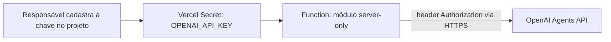

# OpenAI e armazenamento da secret

Desenho em 2026-11-13. Define onde a credencial ficará e como será usada; nenhuma chave é criada, lida, copiada ou solicitada nesta etapa.

## Integração escolhida

Usar apenas **Agents API e seu web search nativo**. A capacidade multimodal do modelo recebe a imagem; não é necessário GPT Image para analisá-la. Não haverá integração separada com Responses API, Chat Completions, Agents SDK, GPT-Live, Realtime, MCP ou sandbox na V1.

A [Agents API](https://developers.openai.com/api/docs/guides/agents-api/overview) gerencia sessões. O [contrato de criação](https://developers.openai.com/api/reference/resources/beta/subresources/agents/subresources/sessions/methods/create) admite `input_image` e `environment.type = none`. Usar derivada inline/data URL dentro dos limites, sem hospedar foto em URL pública.

O [web search nativo](https://developers.openai.com/api/docs/guides/agents-api/tools/web-search) pode ser habilitado em modo `live`, com domínios permitidos. Omitir essa ferramenta nas sessões visual e de síntese; habilitá-la apenas na sessão de pesquisa. Não copiar parâmetros de web search da Responses API: os contratos são distintos.

Um modelo configurável deve suportar as capacidades escolhidas e estar disponível no projeto. Validar acesso/SDK na implementação. O [quickstart](https://developers.openai.com/api/docs/guides/agents-api/quickstart) documenta as permissões de Agents e inferência; uma permissão de inferência chamada `api.responses.write` não implica adicionar uma integração separada à Responses API.

## Decisão: Secret do projeto Vercel

A opção recomendada para esta V1 é o armazenamento nativo de variáveis do projeto, com **tipo Secret**, usando o nome **`OPENAI_API_KEY`**.

Local planejado: **Vercel Dashboard → projeto visual-opsec-preflight → Settings → Environment Variables → OPENAI_API_KEY → Secret → Production**. O nome/projeto efetivo será confirmado na implantação.

As [variáveis Vercel são criptografadas em repouso](https://vercel.com/docs/environment-variables). O tipo [Secret](https://vercel.com/changelog/environment-variables-now-use-config-and-secret-types) oculta o valor de leitura posterior no painel, mantendo-o disponível ao deployment. O código do servidor ainda consegue lê-lo; Secret não torna a chave inacessível a código/dependências comprometidos.

É o cofre de credenciais suficiente para este desenho, sem adicionar HashiCorp Vault, AWS Secrets Manager ou outro serviço. Não equivale a um vault dedicado com todas as funções de auditoria, rotação dinâmica e credenciais temporárias. Os vaults da Agents API destinam-se a credenciais que ferramentas usam; a chave que autentica nossa aplicação fica na Vercel, fora do contexto do agente.

## Fluxo da chave

O módulo de integração lê a variável durante execução no servidor e a usa somente na autenticação do cliente HTTP/SDK oficial. A plataforma também pode disponibilizar variáveis ao build; o projeto não executa análise nem chamadas OpenAI durante build, geração estática ou preview de interface.

Não colocar o valor em `NEXT_PUBLIC_*`, código React cliente, HTML, localStorage, cookies, arquivo público, GitHub, prompts, instruções, ferramentas, respostas de erro ou logs. Não transmitir `process.env` inteiro. A UI de configuração pode informar “integração disponível/indisponível”, nunca retornar o valor.

## Separação de ambientes

| Ambiente | Destino planejado |
| --- | --- |
| Production | `OPENAI_API_KEY` como Secret com chave exclusiva do projeto/ambiente de produção |
| Preview | Sem chave por padrão; uma chave distinta e limitada somente para preview revisado e protegido |
| Development | Chave separada em `.env.local` ignorado pelo Git quando a implementação exigir testes locais |
| Repositório | Somente documentação e futuro `.env.example` com valores vazios |

Não presumir que Secret de Production/Preview pode ser baixada para uso local. Permissões de chave devem ser mínimas para Agents e inferência, com escopo de projeto e controles de uso. Preview de PR não confiável não recebe credenciais de produção.

`CASE_SIGNING_SECRET` será uma segunda Secret, aleatória e independente, para assinar a cookie de referência do caso. Ela não autentica chamadas OpenAI. Variáveis como `OPENAI_MODEL` e limites da aplicação são Config, sem conteúdo sensível.

## Cadastro e rotação previstos

Somente na etapa futura de implementação/implantação: o responsável informa o valor diretamente no painel/fluxo seguro do projeto correto, sem colá-lo no chat ou em comandos registrados. Nenhum segredo precisa existir para revisar estes documentos.

Para rotação: criar credencial substituta com mesmo escopo → atualizar Secret → gerar novo deployment → validar o deployment novo → revogar a chave anterior. Mudanças de variáveis só chegam a novos deployments; deployments antigos precisam ser considerados e não devem servir como rollback com chave revogada.

Suspeita de exposição: revogar a chave comprometida imediatamente, substituir e revisar uso. Não aguardar uma rotação sem indisponibilidade nesse cenário. Recriar/validar deployments de rollback conforme necessário.

Acesso ao painel e ao repositório deve ser restrito ao responsável. Logs recebem IDs de requisição, códigos e métricas; filtram headers de autenticação, payloads, cookies e mensagens de erro que possam conter dados. Ausência de chave ou acesso negado produz erro de configuração sanitizado; nunca uma integração falsa.

## O que ainda precisa de verificação prática

Disponibilidade e custo do modelo, acesso à Agents API, limites de imagem inline, comportamento das citações/itens de busca, cancelamento/exclusão de sessões e configuração efetiva de proteção e secrets da Vercel. São verificações futuras, não resultados desta etapa. Não há promessa de retenção zero nos provedores.
